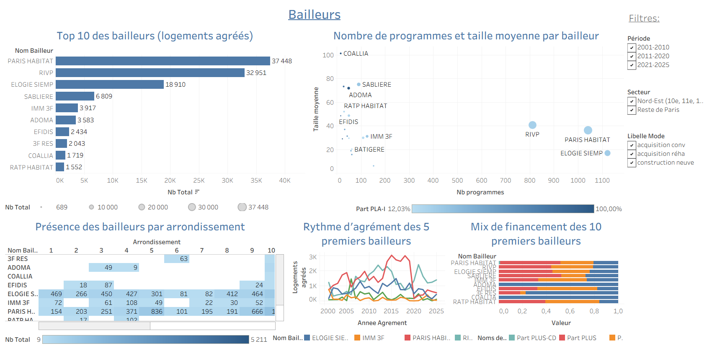

# Logements sociaux à Paris (2001-2025) : combien, où, et qui ?

Projet de data visualisation sur des données ouvertes : analyse des logements sociaux agréés à Paris entre 2001 et 2025.

**Problématique :** la production de logements sociaux à Paris est-elle régulière et répartie, ou concentrée dans le temps, dans l'espace et entre quelques bailleurs ?

## Données

- Source : https://www.data.gouv.fr/datasets/programmes-de-logements-sociaux-finances-a-paris
- 4 293 lignes, 18 colonnes, 130 471 logements agréés, 72 bailleurs, de 2001 à 2025
- Fichier utilisé : `logements_sociaux_paris.csv`

## Outils

- **Navicat (MySQL)** : base de données et requêtes SQL
- **Tableau Desktop** : tableaux de bord

## Ce que j'ai fait

1. Import du CSV dans MySQL avec Navicat (table de travail `stg_logements`).
2. Organisation des données en tables (`bailleur`, `nature_programme`, `mode_realisation`, `financement`) et création de la vue `v_financement` pour Tableau.
3. Vérification des chiffres : 4 293 lignes, 130 471 logements, 72 bailleurs.
4. Requêtes d'analyse en SQL.
5. Création des tableaux de bord dans Tableau.

Choix à signaler : `id_livraison` est stocké en texte (certains identifiants contiennent des lettres, comme `CPE12`), et les lignes de correction comptable (valeurs négatives) sont conservées pour que le total reste exact.

## Tableaux de bord

### 1. Combien, et à quel rythme ?
Chiffres clés, logements agréés par année, cumul, top des bailleurs, nature de programme et mode de réalisation.

### 2. Où ?
Cartes des programmes, densité, logements par arrondissement.

### 3. Qui ?
Top des bailleurs, taille des programmes, mix de financement, présence par arrondissement.

## Principaux résultats

- 130 471 logements agréés, avec un pic en 2016 (7 502) puis une forte baisse : 2 908 en 2020 et 2 657 en 2024.
- 5 arrondissements (13e, 20e, 15e, 18e, 19e) concentrent 54 % des logements.
- 3 bailleurs (Paris Habitat, RIVP, Elogie-Siemp) produisent environ 68 % du total.

## Limites

- Les données mesurent des agréments par année, pas l'évolution du parc de logements.
- Environ 2,5 % des logements n'ont pas de bailleur renseigné.
- Pas de données de population ni de revenus : on ne mesure pas les besoins.

## Fichiers du dépôt

- `creation_base.sql` : création des tables et de la vue
- `analyses.sql` : requêtes de contrôle et d'analyse
- `Classeur1.twbx` : classeur Tableau (données incluses)
- `Classeur1.pdf` : export PDF du classeur
- `Vue d'ensemble.png`, `Concentration des logements sociaux.png`, `Bailleurs.png` : captures des tableaux de bord
- `logements_sociaux_paris_clean.csv` : données

## Reproduire le projet

1. Créer la base `bdd_logements` dans MySQL (via Navicat).
2. Importer le CSV dans une table nommée `stg_logements` (première ligne = en-têtes).
3. Exécuter `creation_base.sql`, puis `analyses.sql` pour retrouver les chiffres de contrôle.
4. Ouvrir `Classeur1.twbx` dans Tableau (les données sont incluses, aucune connexion à la base n'est nécessaire).
